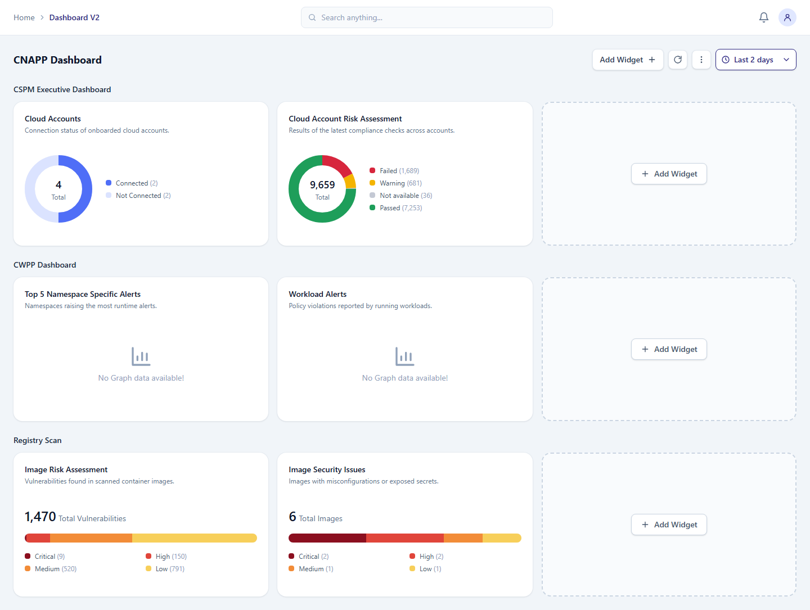

# CNAPP Dashboard

A configurable security dashboard. The page is rendered entirely from a JSON config of categories and widgets, and the user can add, remove, hide, show and search widgets. Changes are kept in a Zustand store and saved to `localStorage`.

**Live demo:** https://cnapp-dashboard.pages.dev



## Features mapped to the requirements

| # | Requirement | How it is met |
| --- | --- | --- |
| 1 | JSON drives the dashboard: categories, each with widgets | `src/data/dashboard.json` holds the three categories (CSPM Executive Dashboard, CWPP Dashboard, Registry Scan) and their widgets `{ id, name, text, type?, data? }`. It is loaded into the Zustand store and every section and card is rendered from store state. |
| 2 | Add and remove widgets per category dynamically | Store actions `addWidget`, `removeWidget`, `setWidgetVisibility` and `applyWidgetChanges` update a single category at a time. The UI re-renders immediately and the layout persists across reloads. |
| 3 | Widget content can be random text | New widgets are `text` widgets that show the text the user entered. The seeded widgets show sample charts (donut, stacked bar) or a "No Graph data available!" placeholder, as in the mockup. |
| 4 | "+ Add Widget" asks for name and text and adds to that category | Every category ends with a dashed "+ Add Widget" card that opens the drawer on that category's tab. The drawer has a name and text form; "Add to list" stages the widget and Confirm adds it to the category. |
| 5 | Remove with a cross icon, or uncheck in the category panel | Each card has a labelled cross button. The drawer lists every widget of the selected category (tabs: CSPM, CWPP, Image) as checkboxes; unchecking hides it, checking shows it again. Drawer changes apply only on Confirm, Cancel discards them. |
| 6 | Search across all widgets | The top bar search filters widgets in every category by name or text, case-insensitively, shows the match count, and shows a "No widgets match" state with a Clear search button. |

### Extras

- **Persistence:** the layout is saved to `localStorage` through a wrapper that never throws (private mode or blocked storage just means no persistence). "Reset to default" in the kebab menu restores the JSON config.
- **Accessibility:** every icon button has an accessible label; the drawer is a modal dialog with a focus trap, Escape to close, focus returned to the opener, and the page behind made `inert`; category tabs and the kebab menu support arrow keys, Home and End; charts carry a text summary for screen readers; search results are announced through a live region.
- **Responsive:** one column on phones, two on tablets, three on desktop. The drawer becomes full width on small screens.
- **Header controls** from the mockup: breadcrumb, refresh (visual feedback only, since the data is static), kebab menu and a "Last 2 days" range select.

## Tech choices

| Choice | Why |
| --- | --- |
| **React 18 + TypeScript** | Typed widget and category models catch config mistakes at build time. |
| **Vite** | Fast dev server and a plain static build that deploys anywhere. |
| **Zustand** | The state is one small slice (categories plus a search query). Zustand gives a typed store with plain functions as actions, no providers or boilerplate, and a `persist` middleware for `localStorage`. Redux Toolkit would work too but adds ceremony that this size of app does not need. |
| **Tailwind CSS v4** | Fast to match the mockup's spacing and colours without a separate stylesheet per component. |
| **Hand-rolled SVG charts** | Two simple chart shapes (donut and stacked bar) are a few lines of SVG and CSS each, which keeps the bundle small (about 55 kB gzipped JS) instead of pulling in a chart library. |
| **Vitest + React Testing Library** | Shares Vite's config and runs the store and component tests in a jsdom environment with a real `localStorage`. |
| **Playwright** | Drives the built app in a real Chromium for the end-to-end flows. |

### State design

- Removing a widget sets `hidden: true` rather than deleting it, so it stays in its category and can be re-checked in the drawer.
- Search is derived, not stored as a filtered copy: `filterCategories(categories, query)` is a pure function used by the page and covered by tests.
- The drawer stages its edits in local component state and commits them in one `applyWidgetChanges` call, so Cancel really cancels.
- Only `categories` is persisted; the search box starts empty on every visit.

## Project structure

```
src/
  data/dashboard.json        Dashboard config: categories and widgets
  types.ts                   Category, Widget and chart types
  store/
    dashboardStore.ts        Zustand store: add, remove, toggle, apply, search, reset
    dashboardStore.test.ts   Vitest unit tests for the store and search
  test/setup.ts              Test setup: jest-dom matchers and cleanup
  lib/
    filterWidgets.ts         Pure search filter across all categories
    safeStorage.ts           localStorage wrapper with try/catch
    id.ts                    Unique id helper
  hooks/
    useFocusTrap.ts          Focus trap and Escape handling for the drawer
  components/
    TopBar.tsx               Breadcrumb, search box, notifications, account
    DashboardHeader.tsx      Title, Add Widget, refresh, kebab menu, time range
    ActionsMenu.tsx          Keyboard-accessible kebab dropdown
    CategorySection.tsx      One category: heading and responsive widget grid
    WidgetCard.tsx           Card with title, remove button and body by widget type
    AddWidgetCard.tsx        Dashed "+ Add Widget" placeholder card
    AddWidgetDrawer.tsx      Right-side drawer: tabs, checkboxes, new widget form
    EmptySearchState.tsx     Shown when no widget matches the search
    charts/                  DonutChart, StackedBar, ChartLegend, EmptyChart
    icons.tsx                Inline SVG icons
    Dashboard.test.tsx       React Testing Library component tests
  App.tsx                    Page layout and drawer state
  main.tsx                   Entry point
e2e/dashboard.spec.ts        Playwright end-to-end tests
playwright.config.ts         Playwright config (Chromium, vite preview web server)
.github/workflows/ci.yml     CI: lint, unit tests, build, end-to-end tests
docs/                        Screenshots (desktop and mobile)
```

## Running locally

Requires Node.js 20 or newer.

```bash
npm install       # install dependencies
npm run dev       # start the dev server at http://localhost:5173
npm run build     # type-check and build to dist/
npm run preview   # serve the production build locally
npm test          # run the unit and component tests once
npm run test:e2e  # run the Playwright end-to-end tests
npm run lint      # run ESLint
```

## Testing

### Unit and component tests (Vitest)

```bash
npm test             # run once
npm run test:watch   # watch mode
```

- `src/store/dashboardStore.test.ts` covers the store actions (add, remove, toggle, apply drawer changes, reset), persistence to `localStorage` and the search filter.
- `src/components/Dashboard.test.tsx` uses React Testing Library to render the widget card and the full app, then removes a widget, adds one through the drawer and searches, the same way a user would.

### End-to-end tests (Playwright)

```bash
npx playwright install chromium   # first run only
npm run test:e2e
```

The suite in `e2e/` runs in Chromium against the production build: Playwright builds the app and starts `vite preview` on port 4173 by itself. It covers:

- the three categories and six widgets rendered from the JSON config
- removing a widget with its cross button
- adding a widget through the drawer (name, text, Add to list, Confirm) into the right category, plus form validation
- unchecking a widget in the drawer to hide it and checking it to show it again
- Cancel discarding staged changes
- search by name and by text, the empty state and Clear search
- the layout surviving a reload, and Reset to default
- Escape closing the drawer and returning focus to the button that opened it
- a phone-sized viewport: one column, no horizontal scroll, full-width drawer

To run the same suite against a deployed copy, set `BASE_URL`, for example `BASE_URL=https://example.com npm run test:e2e`. No local server is started in that case.

## Continuous integration

`.github/workflows/ci.yml` runs on every push and pull request, on Ubuntu with Node.js 20:

1. `npm ci`
2. `npm run lint`
3. `npm test`
4. `npm run build`
5. `npx playwright install --with-deps chromium`, then `npm run test:e2e`

If the end-to-end step fails, the Playwright HTML report is uploaded as a build artifact.

## Deployment

`npm run build` outputs a static site in `dist/` with `base: '/'`.

- **Cloudflare Pages:** build command `npm run build`, output directory `dist`.
- **Vercel:** framework preset Vite, build command `npm run build`, output directory `dist`.

## Screenshots

| | Desktop | Mobile |
| --- | --- | --- |
| Default view | [desktop-1-default](docs/desktop-1-default.png) | [mobile-1-default](docs/mobile-1-default.png) |
| Add Widget drawer | [desktop-2-drawer](docs/desktop-2-drawer.png) | [mobile-2-drawer](docs/mobile-2-drawer.png) |
| After adding a widget | [desktop-3-after-add](docs/desktop-3-after-add.png) | [mobile-3-after-add](docs/mobile-3-after-add.png) |
| Search results | [desktop-4-search](docs/desktop-4-search.png) | [mobile-4-search](docs/mobile-4-search.png) |
| No search results | [desktop-5-search-empty](docs/desktop-5-search-empty.png) | [mobile-5-search-empty](docs/mobile-5-search-empty.png) |
| Kebab menu | [desktop-6-menu](docs/desktop-6-menu.png) | [mobile-6-menu](docs/mobile-6-menu.png) |
